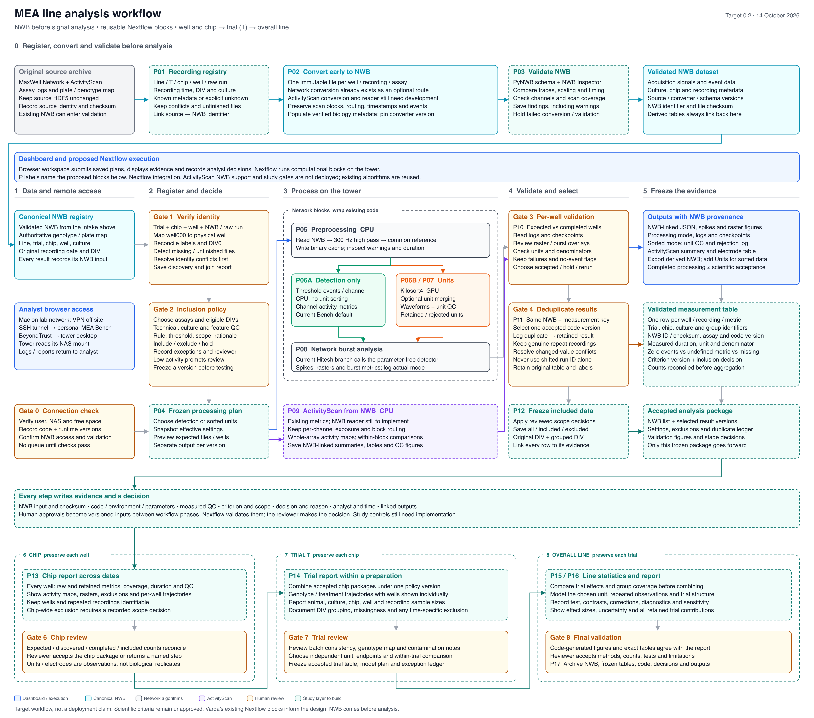
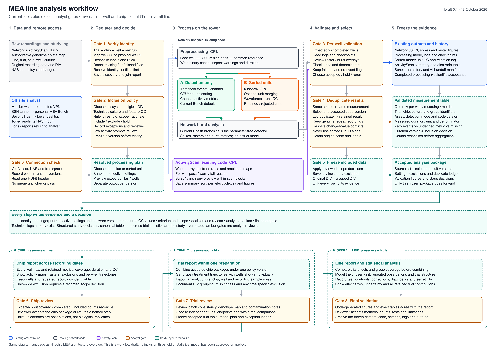

# Line analysis workflows

Two diagrams describe reproducible MEA analysis from individual recordings and wells to chip, trial T and overall-line results. They use the same diagram style as the [existing pipeline architecture](../../architecture/architecture-overview.svg).

These are design documents. They do not enable jobs, change scientific defaults or establish that the complete study workflow has been implemented.

## NWB before analysis, target 0.2

Updated 14 October 2026. Raw sources and study metadata are registered, converted to NWB and validated before signal analysis. Each result retains its recording/well identity, NWB identifier and processing version through chip, trial and line summaries.

[Editable SVG](mea-line-workflow-nwb-first.svg) · [PNG preview](mea-line-workflow-nwb-first.png)



### Read the chart

- Cyan boxes describe the NWB acquisition dataset and its provenance. Original HDF5 sources remain unchanged.
- P01–P17 label proposed computational boundaries that can become Nextflow processes or small subworkflows.
- Amber boxes are analyst review points: identity, policy, QC, duplicate selection and report acceptance.
- Dashed teal boxes and the dashed ActivityScan box identify study controls/adapters to implement.
- Existing algorithms can be reused, but the full diagram is not a deployment or validation claim.

The intended sequence is registration → NWB conversion and validation → approved processing plan → measurements and QC → canonical result selection → frozen inclusion table → chip reports → trial T reports → overall-line statistics and report → accepted archive.

### Current support and remaining work

The current [Network NWB route](../../NWB.md) converts per-well Network recordings and analyzes the resulting NWB files when enabled. ActivityScan still reads its original on-chip files. The target requires an ActivityScan NWB converter/reader preserving scan blocks, routed electrodes, timestamps and per-electrode exposure. Sequential scan blocks must not be treated as simultaneous whole-array measurements.

NWB validation must cover schema/best-practice findings and separate comparisons with the raw signal, including scaling, timing, sample/channel counts and electrode mapping. Detection-only channel events retain their electrode meaning; sorted units can be exported as NWB Units.

Study metadata, scoped inclusion decisions, canonical deduplication, chip/trial/line statistics and reviewer gates remain additions around the existing processing. Source defaults are not approved lab criteria. Missing measurements, undefined metrics and valid zero-event recordings need separate statuses.

The identified [MEA Nextflow framework](https://github.com/BenShalomLab/MEA-ephys-pipeline/tree/nersc-reusable-setup) already defines processing, sorting, curation, visualization, reports, bursts and NWB export as processes. It is a candidate backbone, subject to configuration/version reconciliation and a representative execution pilot. This design was informed by that branch at `9d0173eecf3a5d7c58bdc5102f4bcaa6bacf8709` and the Orchestration-MEA baseline at `6e78eaf9fbd5b200b5c7e18dcd406e139e255be0`.

Human approvals are versioned inputs between workflow phases. The application must enforce who can approve and verify that a decision applies to the exact dataset/configuration/model version. Nextflow execution logs complement the scientific decision log; successful processing alone does not establish scientific acceptance.

A dashboard provides the analyst's browser controls and evidence views. Nextflow executes the blocks, and NWB stores the standardized acquisition data. Shared-user access and study-review controls are separate application additions.

## Earlier draft, baseline 0.1

Prepared 13 October 2026. This version documents the raw-input processing paths with proposed analyst gates and study-level summaries, before NWB was made the common early input in the target design.

[Editable SVG](mea-line-workflow-baseline.svg) · [PNG preview](mea-line-workflow-baseline.png)



## Regenerate the SVGs

Run from the repository root with Python 3:

```sh
python3 docs/workflows/line-analysis/generate_baseline.py
python3 docs/workflows/line-analysis/generate_nwb_first.py
```

The scripts reuse `docs/architecture/make_diagrams.py`, need only the Python standard library and write an SVG plus a layout-check JSON file in this directory. The JSON records any estimated text overflow. PNG previews are rendered from the SVGs; inspect the render after changing a figure.
